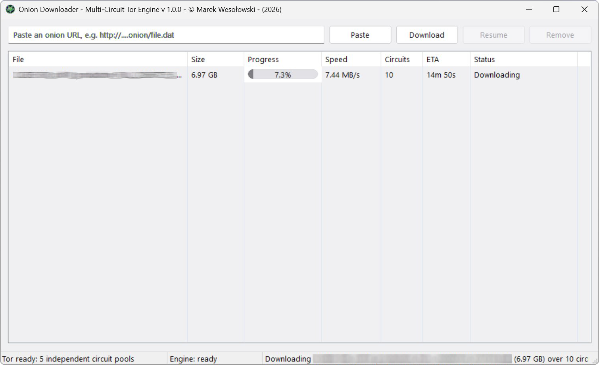

# Onion Downloader - Native Multi-Circuit Tor Downloader

**A compact, self-contained Windows downloader for Onion services, written in C++23 directly against WinAPI and powered by several independent Tor circuits.**

Onion Downloader combines a graphical interface and a complete command-line tool in one **2.67 MiB (2,801,152-byte)** x64 executable. The program needs no installer, .NET runtime, Visual C++ Redistributable or loose `tor.exe`: its client-only Tor engine is compressed into the application resources and extracted only when required. A fully native **Windows on ARM (ARM64)** build is available too - `od_arm64.exe`, carrying its own AArch64 Tor engine rather than running x64 under emulation.




---

## Why Onion Downloader?

Ordinary browsers normally fetch one file through one Tor circuit. Onion Downloader splits a range-capable HTTP download into parallel parts and distributes the work over independent Tor processes and circuits. Slow circuits can therefore work alongside fast ones instead of limiting the entire transfer to a single route.

Actual speed depends on the Onion service, its range support, the network and available Tor relays. The architecture is designed for throughput without sacrificing correct fallback and resumability.

## Two heads, one engine

Onion Downloader is a genuine **dual-mode application**. Running `od_x64.exe` (or `od_arm64.exe`) without arguments opens the native graphical interface; supplying a URL turns the same executable into a console downloader that behaves naturally in scripts and terminals. The two modes are not separate front ends bundled side by side. They share the same parser, Tor process pool, SOCKS5 implementation, range scheduler, part-file writer and resume format.

The GUI head is designed for direct use: Ctrl+V works at window level, dropped URLs land in the address field, queue state survives a restart, and Pause/Resume follows the selected row. The CLI head exposes the same engine without creating a window. An invalid switch produces a useful error instead of unexpectedly falling through into graphical mode.

## Features

- **One native executable per architecture** — GUI, CLI and compressed Tor payload in a single file
- **Native x64 and ARM64** — separate self-contained builds (`od_x64.exe`, `od_arm64.exe`), each embedding its **own native** Tor engine; the ARM64 build runs natively on Windows on ARM, not through x64 emulation
- **Multi-circuit engine** — 10 parallel workers by default and an automatically selected pool of 2–8 independent Tor daemons
- **Segmented HTTP Range downloads** — workers write directly to their assigned regions of one part file
- **Correct fallback** — switches to a normal single stream when the server does not support byte ranges
- **Reliable pause and resume** — progress lives beside the target as `<file>.odpart` and `<file>.odmeta`; metadata is written atomically and periodically rather than on every block
- **Session recovery** — unfinished GUI entries return after restart in a clear paused state; downloading resumes only when requested
- **Native GUI** — system light/dark mode, Mica on Windows 11 and PerMonitorV2 DPI awareness
- **Fast input** — paste an Onion URL with **Ctrl+V** anywhere in the window or drag and drop it onto the application
- **System Downloads by default** — both GUI and CLI use the current user's Windows Downloads known folder unless another directory is selected
- **Client-only Tor 0.4.9.11** — relay, directory-authority and directory-cache functionality removed; Onion proof-of-work client support retained
- **No third-party runtime DLLs** — Tor's minimized OpenSSL 3.5.7, libevent and zlib dependencies are statically linked
- **Clean process lifetime** — Tor children are assigned to a Windows job and do not remain behind after the downloader exits

---

## Installation

Download `od.7z` from the [`latest` release](https://github.com/wesmar/OnionDownloader/releases/tag/latest) and extract it with password `github.com`. The single archive holds **both** native binaries: run `od_x64.exe` on Intel/AMD, or `od_arm64.exe` on **Windows on ARM**.

No installation is required. The first connection prepares the embedded Tor engine under `%LOCALAPPDATA%\od\tor\bin`. A fingerprint of the embedded cabinet makes cache updates deterministic when a newer build is installed.

## Graphical interface

Run `od_x64.exe` (or `od_arm64.exe` on Windows on ARM) without arguments. Paste or drop an `http://...onion/...` address, add it to the list and start the download. Selecting an unfinished row exposes the appropriate Pause or Resume action. Removed incomplete downloads can keep their part files for later recovery.

The list deliberately uses a restrained gray palette: active progress is lighter, completed work darker, and controls follow the system theme.

## Command line

```text
od_x64.exe [options] <URL>   (od_arm64.exe on Windows on ARM)

  <URL>                  Target HTTP URL, normally an .onion mirror
  -s, --split <N>        Parallel workers (default: 10, maximum: 64)
  -c, --circuits <N>     Independent Tor daemons (default: auto, 2-8)
  -o, --out <dir>        Destination directory (default: user Downloads)
  -g, --gui              Launch the GUI
  -h, --help             Show help
  -v, --version          Show version information
```

Examples:

```bat
od_x64.exe http://example.onion/dataset.zip
od_x64.exe -s 20 -c 8 -o D:\Data http://example.onion/bigfile.bin
od_x64.exe --gui
```

Unknown switches are rejected with a message and usage information; they never silently launch the GUI.

## Resume format

For an unfinished `archive.zip`, Onion Downloader creates:

```text
archive.zip.odpart    pre-sized data file with completed ranges in place
archive.zip.odmeta    compact JSON metadata required to validate and resume it
```

The metadata is refreshed at controlled intervals and replaced atomically. On completion both helper files disappear and the final filename remains. A GUI-wide `session.json` stores only the queue state and is not used as a substitute for per-file resume metadata.

---

## Architecture

```text
URL
 └─ download coordinator
     ├─ Tor daemon 1 ─ SOCKS5 ─ worker/range 1...
     ├─ Tor daemon 2 ─ SOCKS5 ─ worker/range 2...
     └─ Tor daemon N ─ SOCKS5 ─ worker/range N...
                              └─ one random-access .odpart file
```

The program implements its own HTTP, SOCKS5, range scheduling, part-file and resume engines. Tor supplies only transport through the Onion network. There is no libcurl, aria2, browser engine or web framework in Onion Downloader.

The icon resource begins with a valid Windows icon and carries an appended LZX-21 cabinet containing `tor.exe`. Extraction uses Windows' native Cabinet FDI API directly from memory. The resulting Tor executable imports only Windows system DLLs.

## How 3 MB contains an application and Tor

The small size is not the result of removing useful downloader features. It comes from treating every layer as part of one size budget:

- **One PE for GUI and CLI** — there is no second launcher, helper executable or duplicated download engine.
- **Native WinAPI interface** — controls, painting, DPI handling, dark mode, Mica, clipboard and drag-and-drop use Windows directly, with no GUI framework attached.
- **Static MSVC runtime** — the application remains self-contained, while release optimization and linker elimination discard unreachable C++ code.
- **Purpose-built Tor** — the upstream source is compiled as a client only. Relay, directory-authority, directory-cache, test, manual and system-wide configuration machinery is not carried into the final engine.
- **Pruned cryptography build** — OpenSSL is built only with the families Tor's selected client configuration needs; command-line programs, tests, documentation, legacy provider and unused protocols/algorithms are disabled before compilation.
- **Function-level garbage collection** — C/C++ functions and data receive separate sections; the MinGW linker removes sections that the final Tor client cannot reach.
- **Static dependency closure** — the required pieces of OpenSSL, libevent and zlib become part of `tor.exe`, so no collection of adjacent DLLs has to be shipped.
- **LZX-21 cabinet packing** — Windows' strongest classic Cabinet compression turns the roughly 6.54 MiB specialized Tor PE into an approximately 2.15 MiB payload.
- **The icon is the container** — the cabinet is appended after a valid ICO image. Windows still sees the normal application icon, while Onion Downloader locates and expands the payload through `cabinet.dll`.
- **Content-aware repacking** — `build.ps1` hashes both Tor and the original icon. An ordinary source rebuild reuses an already correct compressed resource; `-RepackTor` exists for an intentional refresh.
- **Content-aware runtime cache** — an eight-byte fingerprint beside the extracted Tor identifies the exact embedded cabinet. A matching engine is reused with no decompression; a changed build replaces it automatically.

The result is a **2.67 MiB final `od_x64.exe`** containing the native downloader plus its complete Tor transport. Nothing is fetched silently at first run, and `tor.exe` never has to sit loose beside the program.

## Building Onion Downloader

Requirements:

- Windows x64 host
- Visual Studio with the MSVC x64 C++ toolchain, plus the **ARM64 build tools** component for the ARM64 target (current project: v145)
- PowerShell

Build the application (both architectures by default):

```powershell
Set-ExecutionPolicy -Scope Process Bypass
.\build.ps1                  # builds x64 AND ARM64
.\build.ps1 -Platform x64    # or a single architecture
.\build.ps1 -Platform ARM64
```

`build.ps1` detects the newest usable Visual Studio installation and, by default, builds **both** native targets - writing `bin\od_x64.exe` and `bin\od_arm64.exe`; `-Platform x64` or `-Platform ARM64` builds just one. The repository does not carry a loose `resources\tor.exe` or `resources\tor-arm64.exe`: each compressed Tor payload already lives inside the checked-in icon (`app.ico` / `app-arm64.ico`), so an ordinary clone builds straight from it with no Tor rebuild. Only after a `build-tor` script regenerates the loose engine does an explicit repack apply:

```powershell
.\build.ps1 -Clean -RepackTor
```

### Windows on ARM (native ARM64)

The ARM64 target is built by default (and on its own with `.\build.ps1 -Platform ARM64`), producing `bin\od_arm64.exe` (**2.13 MiB, 2,235,392 bytes**) with a **native AArch64** Tor engine embedded from the checked-in `resources\app-arm64.ico` - nothing runs under x64 emulation. Both layers are genuine ARM64 PEs (`IMAGE_FILE_MACHINE_ARM64`) that import only Windows system DLLs. Exactly like x64, an ordinary clone needs only Windows and MSVC (with the ARM64 build tools component): the ARM64 Tor payload is already inside the checked-in icon, so no WSL is required to build the app. Regenerating the ARM64 Tor engine itself uses `build-tor-arm64.sh`, which cross-compiles with **llvm-mingw** (clang, `aarch64-w64-mingw32`) - the stock MinGW that targets x86-64 Windows cannot emit ARM64 - and builds OpenSSL through a small custom `mingw-arm64` target because upstream ships none.

## Rebuilding the minimized Tor payload

`build-tor.sh` is the reproducible WSL/MinGW path used for the bundled engine. It builds pinned Tor, OpenSSL, libevent and zlib sources, verifies the resulting client modules, copies the executable to `resources/tor.exe`, and asks `build.ps1` to repack it.

### A technical curiosity: a Linux-built native Windows Tor

The embedded engine is **Tor 0.4.9.11, the newest official C-Tor release available when this build was prepared**. It was compiled in **Ubuntu 26.04 under WSL**, but it is not a Linux binary: MinGW-w64 cross-compiles and statically links a genuine Windows x64 PE executable.

Its configuration enables the GPL components and a fully static Tor, targets Windows 7 or newer at API level, gives every function and data object its own linker section, and enables PE exploit mitigations including NX compatibility, ASLR and high-entropy ASLR. At the same time it disables relay and directory-authority modules, unit tests, manuals, the system torrc and GCC's bulky default hardening path. The exact, copyable flag set is preserved in `build-tor.sh` instead of filling this README with a configure transcript.

OpenSSL is likewise built statically with its applications, tests, documentation, legacy provider and unused algorithms/protocols disabled. Link-time section garbage collection then removes code that the selected Tor client cannot reach. This is why the raw specialized `tor.exe` is about **6.54 MiB**, while the ordinary general-purpose Tor Browser executable is appreciably larger. The LZX-21 resource payload is about **2.15 MiB**. Crucially, Onion-service proof-of-work support remains enabled; removing it would make the smaller executable less compatible with services under load.

Run from WSL after installing the normal build tools, Perl, MinGW-w64 and autotools:

```bash
./build-tor.sh
```

This is intentionally a Tor client, not a relay. Proof-of-work support is kept because modern Onion services may require it.

## Source layout

```text
src/core/       download coordination, sessions and part files
src/net/        HTTP, SOCKS5 and Tor process management
src/ui/         native Win32 graphical interface
src/cli/        command-line parsing and output
resources/      icon and manifest resources; app.ico / app-arm64.ico carry the
                compressed x64 / ARM64 Tor payloads (the loose tor.exe /
                tor-arm64.exe are produced by the build-tor scripts, not tracked)
third-party/    embedded-Tor build transparency: pinned sources, exact
                configure flags and reproducible verification artifacts
build.ps1        deterministic Windows application build (-Platform x64 | ARM64)
build-tor.sh     reproducible minimized x64 Tor dependency build (WSL/MinGW)
build-tor-arm64.sh  reproducible native ARM64 Tor build (WSL/llvm-mingw)
```

## License

Onion Downloader's original source code is released under the [MIT License](LICENSE.md).

The embedded Tor executable is a separate GPLv3-or-later program. Tor, OpenSSL, libevent and zlib retain their own licenses and copyright notices. Exact versions, links and build choices are documented in [THIRD_PARTY_NOTICES.md](THIRD_PARTY_NOTICES.md).

## Author

**Marek Wesołowski**  
GitHub: https://github.com/wesmar  
Website: https://kvc.pl

Onion Downloader is actively maintained. Its author develops Windows low-level, security and forensic software across a public GitHub portfolio followed by more than a thousand stargazers. Releases are updated when the downloader, its embedded Tor engine or their build process materially improves.

---

*Copyright © 2026 Marek Wesołowski*
