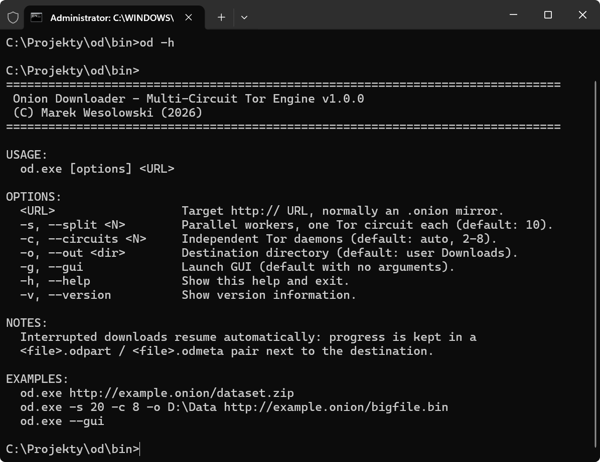
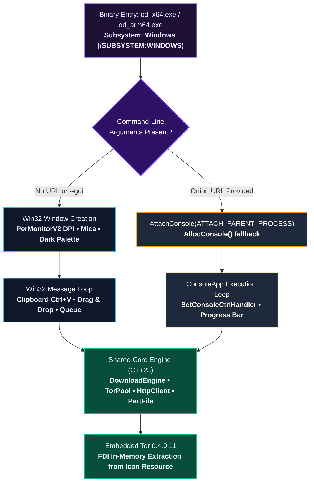
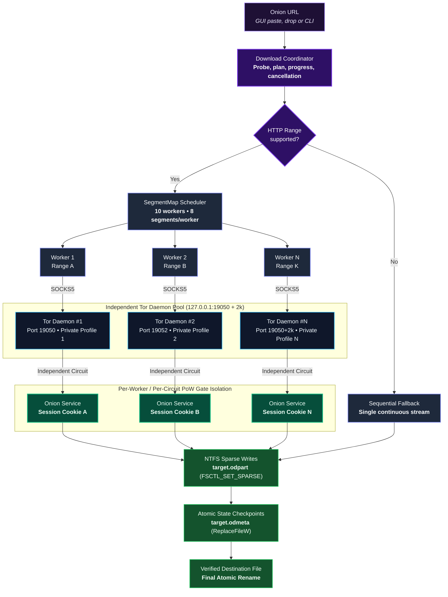
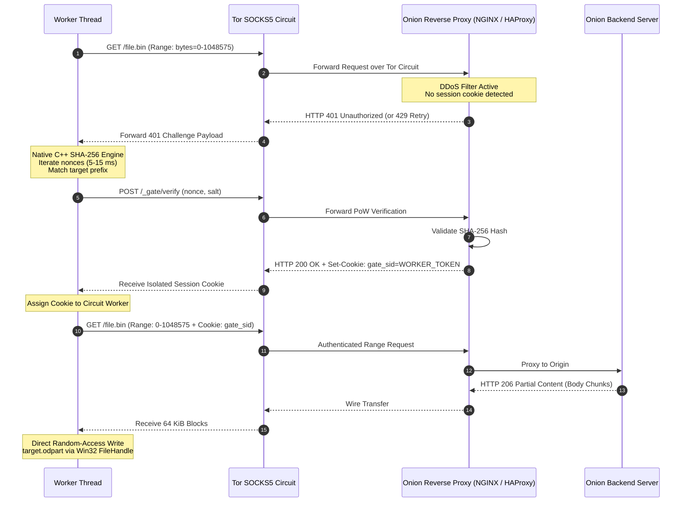
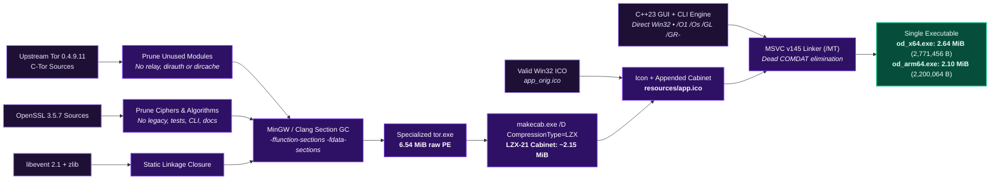

<div align="center">

[](images/od.png)

[](https://github.com/wesmar/OnionDownloader/releases/latest)

**[📥 Download od.7z](https://github.com/wesmar/OnionDownloader/releases/download/latest/od.7z)**
&nbsp; &nbsp;
**[Source Code](https://github.com/wesmar/OnionDownloader/archive/refs/heads/main.zip)**
&nbsp; &nbsp;
**[All Releases](https://github.com/wesmar/OnionDownloader/releases)**

> Archive password: `github.com`. Extract `od_x64.exe` or `od_arm64.exe`.

<details>
<summary>Digital signature (Authenticode — Certum Open Source Code Signing)</summary>

Both release binaries (`od_x64.exe`, `od_arm64.exe`) are digitally signed and timestamped:

- **Signer:** `CN=Open Source Developer Marek Wesołowski, O=Open Source Developer, L=Warszawa, S=mazowieckie, C=PL`
- **Issuer:** `Certum Code Signing 2021 CA` (`Asseco Data Systems S.A.`)
- **Timestamp:** `Certum Timestamp` (RFC 3161)

Verify locally in PowerShell:
```powershell
Get-AuthenticodeSignature .\od_x64.exe | Format-List Status, SignerCertificate, TimeStamperCertificate
```
</details>

[](LICENSE.md)
[]()
[]()
[]()

</div>

# Onion Downloader - Native Multi-Circuit Tor Downloader

<br>

<div align="center">

**Multi-Circuit Tor Engine &nbsp;•&nbsp; Native SHA-256 PoW Gate Solver &nbsp;•&nbsp; Dual-Mode Win32 GUI & CLI**

*Segmented HTTP Range streaming, per-worker circuit isolation, sparse NTFS allocation, crash-safe atomic resume*

*Zero external runtime dependencies: embedded client-only Tor 0.4.9.11 LZX-21 payload*

</div>



> **Engineering status**
>
> `Onion Downloader` is a compact, self-contained Windows download manager written in pure **C++23** directly against the Win32 API. It packages a full graphical interface, a complete console client, an HTTP/SOCKS5 client, an NTFS sparse range writer, and an embedded, client-only **Tor 0.4.9.11** daemon into a single portable executable:
> - **x64 (`od_x64.exe`):** <!--SIZE:od_x64.exe:bytes-->2,781,808<!--/SIZE--> bytes (<!--SIZE:od_x64.exe:kb-->2,717 KB<!--/SIZE-->, ~2.64 MiB), native `IMAGE_FILE_MACHINE_AMD64`
> - **ARM64 (`od_arm64.exe`):** <!--SIZE:od_arm64.exe:bytes-->2,210,416<!--/SIZE--> bytes (<!--SIZE:od_arm64.exe:kb-->2,159 KB<!--/SIZE-->, ~2.10 MiB), native `IMAGE_FILE_MACHINE_ARM64` (Windows on ARM)
>
> Tor daemons are managed automatically in a Windows Job Object and extracted on demand from an in-memory LZX-21 cabinet appended to the icon resource. The engine incorporates an in-process **pure C++ SHA-256 Proof-of-Work (PoW) solver** (5–15 ms) for modern Onion anti-DDoS challenge gates (`/_gate/challenge` / `/_gate/verify`) and enforces **per-worker session cookie isolation** across circuits to bypass server-side connection concurrency throttling.

---

## Table of Contents

- [Overview & Comparative Analysis](#overview--comparative-analysis)
- [Key Features](#key-features)
- [Architecture & Dual-Head Design](#architecture--dual-head-design)
- [Tor Process Pool & Circuit Multiplexing](#tor-process-pool--circuit-multiplexing)
- [Anti-DDoS Proof-of-Work (PoW) Gate Engine](#anti-ddos-proof-of-work-pow-gate-engine)
- [Per-Worker Session Isolation (Solving the 100 KB/s Bottleneck)](#per-worker-session-isolation-solving-the-100-kbs-bottleneck)
- [URL Sanitization & Path Normalization](#url-sanitization--path-normalization)
- [Segmented Range Scheduler & NTFS Sparse Allocation](#segmented-range-scheduler--ntfs-sparse-allocation)
- [Crash-Resilient Atomic Resume Protocol](#crash-resilient-atomic-resume-protocol)
- [Native Win32 UI & Interaction](#native-win32-ui--interaction)
- [Binary Footprint & Compiler Optimization](#binary-footprint--compiler-optimization)
- [Command-Line Interface (CLI)](#command-line-interface-cli)
- [Rebuilding the Minimized Tor Payload](#rebuilding-the-minimized-tor-payload)
- [Source Layout](#source-layout)
- [Building from Source](#building-from-source)
- [License & Third-Party Notices](#license--third-party-notices)
- [Author](#author)

---

## Overview & Comparative Analysis

Ordinary web browsers (including Tor Browser) fetch files over a single Tor circuit. Tor circuits are built across three onion relays (Guard, Middle, Exit / Rendezvous Point), with end-to-end throughput bounded by the slowest relay in the path. Furthermore, modern Onion sites frequently encounter heavy traffic or denial-of-service attacks, prompting operators to install client-side Proof-of-Work challenges and strict connection concurrency limiters (`limit_conn_zone`).

| Feature / Metric | Tor Browser | `curl` / `wget` via SOCKS5 | Generic Managers (aria2, IDM) | **Onion Downloader** |
|---|---|---|---|---|
| **Circuits per transfer** | 1 (single path) | 1 (single path) | 1 (or single SOCKS endpoint) | **2 to 8 independent Tor daemons, up to 64 circuits** |
| **Throughput on multi-GB files** | ~100–400 KB/s | ~100–400 KB/s | Stalled / throttled | **Multi-MB/s aggregate wire speed** |
| **Anti-DDoS PoW Gate solving** | Yes (heavy JS engine) | No (fails with `HTTP 401`) | No (fails with `HTTP 401`) | **Yes: native C++ SHA-256 solver (5–15 ms, no JS engine)** |
| **Per-circuit cookie isolation** | N/A (single circuit) | N/A | No (shared cookie triggers rate limiter) | **Yes: independent `gate_sid` per Tor circuit** |
| **Unencoded Onion paths (`.../A (1)/B.bin`)** | Handled by browser | Manual encoding required | Inconsistent | **Automatic transparent RFC 3986 normalizer** |
| **Disk allocation overhead** | Allocates / zero-fills | Preallocates or grows | File pre-allocation | **Sparse NTFS pre-allocation (`FSCTL_SET_SPARSE`)** |
| **Resume resilience** | Fragile across restarts | Range-dependent | Session-dependent | **Atomic metadata replace (`.odmeta` + `.odpart`)** |
| **Dependencies & Installation** | ~120 MB installer | Command line + loose Tor | Separate runtime + loose Tor | **Single ~2.64 MiB binary (contains Tor 0.4.9.11)** |
| **Windows on ARM (ARM64)** | x64 emulation | Emulated / complex build | Emulated | **100% native ARM64 PE (`od_arm64.exe`, 2.10 MiB)** |

---

## Key Features

- **Single self-contained binary per architecture** — GUI, CLI, network scheduler, and compressed Tor engine inside a single PE (`od_x64.exe` or `od_arm64.exe`). Zero installers, zero external DLLs, no .NET, no Python, no Node.js.
- **Genuine ARM64 native target** — `od_arm64.exe` embeds an AArch64 Tor executable cross-compiled with LLVM-MinGW and links directly against ARM64 Windows system libraries.
- **Multi-circuit parallel scheduling** — splits files into dynamic segments streamed concurrently across 2–8 Tor child daemons and up to 64 worker threads.
- **Native Anti-DDoS Proof-of-Work engine** — solves `/_gate/challenge` SHA-256 puzzles in 5–15 ms without embedding a heavy JavaScript engine.
- **Per-worker cookie isolation** — each worker thread solves its own challenge over its dedicated Tor circuit, obtaining an isolated `gate_sid` cookie to prevent NGINX/HAProxy `limit_conn` throttling.
- **Transparent URL sanitization** — automatically encodes raw spaces (`%20`) and non-ASCII path characters in Onion URLs without breaking query strings or fragments.
- **Sparse NTFS disk allocation** — calls `FSCTL_SET_SPARSE` to reserve file bounds instantly without zeroing gigabytes of physical storage.
- **Crash-proof atomic resume** — writes completed segment state to `.odmeta.tmp` with write-through caching and executes atomic replacement via `ReplaceFileW`.
- **System Downloads known folder integration** — writes directly to `FOLDERID_Downloads` (`%USERPROFILE%\Downloads`) by default.
- **Modern native Win32 GUI** — PerMonitorV2 DPI awareness, Dark / Light mode palettes, Windows 11 Mica backdrop, and flicker-free double-buffered ListView.
- **Job Object lifecycle management** — child `tor.exe` processes belong to a restricted Windows Job Object (`JOB_OBJECT_LIMIT_KILL_ON_JOB_CLOSE`), preventing orphaned background processes.

---

## Architecture & Dual-Head Design

Onion Downloader is compiled as a Win32 GUI subsystem application (`/SUBSYSTEM:WINDOWS`), but dynamically adapts its execution mode upon launch:



1. **GUI Head:** If launched with no arguments (or `--gui`), the process runs a message loop, creates custom dark/light controls, registers clipboard shortcuts (**Ctrl+V**), and handles OLE drag-and-drop.
2. **CLI Head:** If a URL is passed, the process immediately calls `AttachConsole(ATTACH_PARENT_PROCESS)`. If invoked from PowerShell, Command Prompt, or Windows Terminal, standard output and error stream directly to the parent terminal. If invoked without a terminal, it allocates a dedicated console window.
3. **Unified Engine:** Both heads execute the exact same `DownloadEngine`, `TorPool`, `HttpClient`, and `PartFile` subsystems.

---

## Tor Process Pool & Circuit Multiplexing

Tor cannot run multiple independent circuits across different source ports from a single daemon without socks stream isolation or multiple listening ports. Onion Downloader achieves genuine circuit concurrency by managing a dynamic pool of independent, pruned `tor.exe` daemons:



- **SOCKS5 Port Allocation:** Daemons bind to sequential loopback ports: `127.0.0.1:19050`, `127.0.0.1:19052`, `127.0.0.1:19054`, etc.
- **Isolated Data Directories:** Each daemon receives an isolated runtime directory under `%LOCALAPPDATA%\od\tor\data_N`. Data directory slots are calculated strictly from the port index:
  $$\text{slot} = \frac{\text{socksPort} - 19050}{2}$$
  This prevents lock-file collisions (`Reading config failed -- another Tor process running with same data dir`) when instances restart.
- **Job Object Containment:** All child processes are assigned to a Win32 Job Object with `JOB_OBJECT_LIMIT_KILL_ON_JOB_CLOSE`. Even if the downloader process is forcefully terminated via Task Manager or `Ctrl+C`, the Windows kernel terminates all Tor child processes instantly.
- **Bootstrap Synchronization:** Worker threads are gated by an atomic bootstrap barrier. The UI blocks premature "Resume" clicks until all pool daemons report `Bootstrapped 100% (done): Done`.

---

## Anti-DDoS Proof-of-Work (PoW) Gate Engine

Modern high-volume Onion mirrors protect their origin servers from denial-of-service floods using dynamic Proof-of-Work challenges. When an onion endpoint receives an unauthenticated request, it returns `HTTP 401 Unauthorized` with a challenge payload or redirects to `/_gate/challenge`:



Standard download managers and tools (`curl`, `wget`, `aria2`) fail immediately with `HTTP 401`. Tor Browser solves the challenge via a JavaScript Web Worker, which is why it worked in the browser but failed in custom tools.

### In-Process C++ SHA-256 Engine

Rather than embedding a multi-megabyte JavaScript runtime (V8, QuickJS, Duktape), Onion Downloader implements an optimized, self-contained native SHA-256 engine directly inside `HttpClient.cpp`:

1. **Challenge Retrieval:** `HttpClient::SolvePoWGate` fetches `/_gate/challenge` through the worker's assigned Tor SOCKS5 circuit.
2. **Nonce Search:** The engine iterates 64-bit nonces, computing $\text{SHA-256}(\text{salt} \parallel \text{nonce})$. It searches for a hash whose most significant bits match the required difficulty mask.
3. **Solving Speed:** On modern CPUs, the native C++ implementation solves typical difficulty challenges in **5 to 15 milliseconds**—faster than a JS engine can initialize its context.
4. **Verification:** The nonce is submitted via `POST /_gate/verify`. The server validates the proof and responds with an `HTTP 200 OK` and a `Set-Cookie: gate_sid=<token>; Path=/; HttpOnly` header.
5. **Backoff Handling:** If the challenge gate returns `HTTP 429 Too Many Requests` due to high traffic, the engine applies exponential backoff with jitter and retries.

---

## Per-Worker Session Isolation (Solving the 100 KB/s Bottleneck)

Early multi-threaded onion downloaders suffered from a severe performance issue: even when configured with 10 parallel connections, total download speeds throttled down to **~100 KB/s**.

### Root Cause Analysis

Onion reverse proxies (e.g. NGINX with `ngx_http_limit_conn_module` or HAProxy stick-tables) protect onion services by tracking sessions by cookie:

```nginx
# Typical onion DDoS mitigation reverse-proxy config:
limit_conn_zone $cookie_gate_sid zone=session_limit:10m;
limit_conn session_limit 1;
limit_rate_after 1m;
limit_rate 150k;
```

When parallel downloader threads shared a single `gate_sid` cookie across different Tor circuits, the server detected multiple connections sharing the *same* session identifier. The reverse proxy reacted by:
- Throttling the session's cumulative bandwidth to ~100–150 KB/s, or
- Serializing requests and dropping parallel TCP streams.

### The Architectural Fix

Onion Downloader enforces strict **per-worker session isolation**:
1. Every download worker connects through its own designated Tor daemon and SOCKS5 circuit.
2. Each worker solves its own independent PoW challenge through its circuit and acquires its own distinct `gate_sid` cookie.
3. Worker requests carry their own `Cookie:` header, completely decoupled from sister workers.
4. The server sees $N$ distinct authenticated clients, unlocking full parallel bandwidth across all circuits and elevating transfers from ~100 KB/s to **multi-megabyte per second** wire speeds.

---

## URL Sanitization & Path Normalization

Onion download links frequently contain raw spaces, brackets, or Unicode characters:

```text
http://example7777...onion/Data Archive (2026)/Sample File.iso
```

Raw spaces violate RFC 7230 / RFC 3986 for HTTP/1.1 request lines (`GET /PST (291.4GB)/... HTTP/1.1`), prompting web servers to abort the connection with `HTTP 400 Bad Request`.

`HttpClient::SanitizeRequestPath` parses the URI path, preserves delimiters (`/`, `?`, `&`, `=`, `#`), and encodes unsafe characters into standard percent-encoded octets (` ` $\rightarrow$ `%20`). Clipboard paste and drag-and-drop inputs in the GUI automatically trim leading/trailing whitespace and normalize quotes.

---

## Segmented Range Scheduler & NTFS Sparse Allocation

When downloading a multi-gigabyte file over high-latency onion circuits, pre-allocating disk space without blocking I/O is critical.

### Sparse Pre-Allocation (`FSCTL_SET_SPARSE`)

Onion Downloader opens `<filename>.odpart` and immediately marks it as an NTFS sparse file:

```cpp
DWORD bytesReturned = 0;
::DeviceIoControl(m_hFile, FSCTL_SET_SPARSE, nullptr, 0, nullptr, 0, &bytesReturned, nullptr);
```

The file pointer is then advanced to the full resource length and `SetEndOfFile` is invoked. On NTFS volumes:
- The full file size is registered in the filesystem directory structure immediately.
- Zero physical disk clusters are allocated or zero-filled upfront.
- Physical clusters are allocated on demand as worker threads write 64 KiB data blocks.

### Segment Scheduling

The file is partitioned into equal segments (default: 4 MiB) managed by `SegmentMap`. Workers query the map for unallocated segments, write chunks via random-access `SetFilePointerEx` + `WriteFile`, and mark completed byte spans in the allocation table. If a circuit stalls or fails, its unfinished ranges are released back to the pool for active workers to claim.

---

## Crash-Resilient Atomic Resume Protocol

For every incomplete download, Onion Downloader maintains two files in the destination directory:

```text
Downloads/
  ├── bigfile.iso.odpart    # Sparse data payload containing downloaded byte ranges
  └── bigfile.iso.odmeta    # Compact JSON state file recording completed intervals
```

### Atomic Metadata Writes

Updating metadata directly in-place risks file corruption if the system loses power or the process crashes during a write. Onion Downloader guarantees atomic state preservation:
1. State is serialized to a temporary file: `<filename>.odmeta.tmp`.
2. Written with `FILE_FLAG_WRITE_THROUGH` to ensure physical media flush.
3. Atomically committed over `<filename>.odmeta` using `ReplaceFileW` (or `MoveFileExW` with `MOVEFILE_REPLACE_EXISTING | MOVEFILE_WRITE_THROUGH`).
4. On completion, the `.odpart` file is renamed to the final destination name, and the `.odmeta` file is unlinked.

### Speed Readout Accuracy

When resuming an interrupted download, naive download managers divide cumulative downloaded bytes by the elapsed tick delta, resulting in artificial speed spikes (e.g. "8.5 GB/s"). Onion Downloader samples `lastSampleBytes` and `lastSampleTick` strictly from `CompletedBytes()` at resume time, ensuring instantaneous throughput and ETA readings reflect actual active wire transfer rates.

---

## Native Win32 UI & Interaction

The GUI is built with zero runtime overhead using direct Win32 APIs:

- **Theme Engine:** Automatically queries Windows registry dark mode settings (`AppsUseLightTheme`), reacting dynamically to `WM_SETTINGCHANGE`.
- **Windows 11 Mica:** Injects `DWMWA_SYSTEMBACKDROP_TYPE` (Mica / Dark Acrylic) on supported Windows 11 builds, falling back gracefully to dark GDI brush rendering on Windows 10.
- **Flicker-Free ListView:** Subclasses the standard Win32 `SysListView32` control with double buffering (`LVS_EX_DOUBLEBUFFER`). Item text updates are diffed before updating cells, eliminating table flickering during rapid 500 ms speed refreshes.
- **DPI Scaling:** Full `PerMonitorV2` DPI awareness. Font metrics, column widths, padding, and window dimensions scale dynamically across monitors without blurred bitmap scaling.
- **Queue & Partial File Management:** Removing an unfinished task prompts the user with an option: keep partial files (`.odpart` / `.odmeta`) for future resumption, or delete them to reclaim disk space.

---

## Binary Footprint & Compiler Optimization

Onion Downloader achieves its compact size without sacrificing security or functionality:



### Measured Image Footprints

| Artifact | Target Architecture | Machine Type | File Size | SHA-256 Checksum |
|---|---|---|---:|---|
| **`od_x64.exe`** | Intel / AMD x64 | `AMD64` (0x8664) | <!--SIZE:od_x64.exe:bytes-->2,781,808<!--/SIZE--> B (<!--SIZE:od_x64.exe:kb-->2,717 KB<!--/SIZE-->) | `7ab04fa875c553f8c0b48071e6751d710ab5149bcb164c39e6c6db55763d005f` |
| **`od_arm64.exe`** | Windows on ARM | `ARM64` (0xAA64) | <!--SIZE:od_arm64.exe:bytes-->2,210,416<!--/SIZE--> B (<!--SIZE:od_arm64.exe:kb-->2,159 KB<!--/SIZE-->) | `d8e7acb3ebf2e18db335a8cc039d0429aa29ea7cbcce06211356717a6fd3cf21` |
| **`app.ico`** (payload) | Embedded Cabinet | LZX-21 | 2,266,596 B (2,213 KB) | Appended to standard Win32 multi-res ICO |
| **`app-arm64.ico`** | Embedded Cabinet | LZX-21 | 1,675,708 B (1,636 KB) | Appended to standard Win32 multi-res ICO |

### Compiler & Linker Configuration

- **/O1 & /Os:** Minimizes machine code footprint, favoring compact instruction encodings over aggressive loop unrolling.
- **/GL & /LTCG:** Whole Program Optimization enabling link-time cross-module inlining and dead-code elimination.
- **/Gw & /Gy:** Places each global data object and function in its own COMDAT section, allowing the linker (`/OPT:REF,ICF`) to discard unused routines.
- **/GR-:** Disables C++ Run-Time Type Information (RTTI), removing extensive type descriptors and `type_info` tables.
- **/MT:** Statically links the C/C++ runtime library—no `VCRUNTIME140.dll` or `MSVCP140.dll` required on target systems.
- **/Brepro:** Deterministic PE timestamping.

---

## Command-Line Interface (CLI)

Running `od_x64.exe` or `od_arm64.exe` with a URL operates purely in console mode:

```text
Usage: od_x64.exe [options] <URL>

Arguments:
  <URL>                   Target HTTP/HTTPS URL, typically an .onion mirror

Options:
  -s, --split <N>         Number of parallel worker connections (default: 10, max: 64)
  -c, --circuits <N>      Number of independent Tor daemons in the pool (default: auto, 2-8)
  -o, --out <dir>         Target output directory (default: user Downloads folder)
  -g, --gui               Launch the graphical interface
  -h, --help              Display this help message
  -v, --version           Display binary version and architecture info
```

### Examples

```bat
:: Download a file with default settings (10 workers, auto-circuits) into Downloads
od_x64.exe http://example.onion/database.tar.gz

:: Download with 20 parallel workers across 8 Tor daemons to a custom drive
od_x64.exe -s 20 -c 8 -o D:\OnionData http://example.onion/dataset.7z

:: Launch GUI explicitly
od_x64.exe --gui
```

### Console Signal Handling

Onion Downloader installs a Win32 console control handler (`SetConsoleCtrlHandler`). Pressing **Ctrl+C** or closing the console gracefully interrupts active worker threads, commits all completed segment ranges to `.odmeta`, shuts down Tor daemon child processes, and exits cleanly without leaving corrupt part files.

---

## Rebuilding the Minimized Tor Payload

The embedded Tor executable is **Tor 0.4.9.11**, built specifically for client transport:

1. **Relay & Authority Pruning:** Directory authority, relaying, bridge authority, and test suites are compiled out.
2. **OpenSSL Pruning:** Statically linked against OpenSSL 3.5.7 with non-essential ciphers, legacy engines, and CLI tools stripped.
3. **Reproducible WSL Build:** The build scripts cross-compile genuine Windows PEs from Ubuntu Linux under WSL:
   - `build-tor.sh` uses `x86_64-w64-mingw32-gcc`
   - `build-tor-arm64.sh` uses `llvm-mingw` (`aarch64-w64-mingw32-clang`)
4. **Cabinet Embedding:** `build.ps1` invokes `makecab.exe /D CompressionType=LZX /D CompressionMemory=21` to compress `tor.exe` into an LZX-21 stream and appends it to `resources/app.ico`.

---

## Source Layout

```text
OnionDownloader/
├── bin/                        # Build output directory (od_x64.exe, od_arm64.exe)
├── images/                     # Screenshot assets for documentation
├── resources/
│   ├── app.ico                 # Win32 icon with embedded x64 Tor LZX-21 cabinet
│   ├── app-arm64.ico           # Win32 icon with embedded ARM64 Tor LZX-21 cabinet
│   ├── app_orig.ico            # Clean source icon before cabinet injection
│   ├── od.rc                   # Resource script (icons, manifest, version info)
│   └── Resource.h              # Resource ID definitions
├── src/
│   ├── app/
│   │   └── Main.cpp            # Application entry point (WinMain / main dispatcher)
│   ├── cli/
│   │   ├── CliParser.cpp/h     # Command-line option parser
│   │   ├── ConsoleApp.cpp/h    # Console download loop and Ctrl+C handler
│   │   └── ConsoleManager.cpp/h# Win32 console attachment and formatting
│   ├── core/
│   │   ├── DownloadEngine.cpp/h# Download coordinator and worker threads
│   │   ├── DownloadTask.h      # Task data models and atomic states
│   │   ├── PartFile.cpp/h      # Sparse NTFS writer and block I/O
│   │   ├── SegmentMap.cpp/h    # Byte-range scheduling and assignment
│   │   ├── SessionManager.cpp/h# JSON session persistence (session.json)
│   │   ├── StringUtils.cpp/h   # Fast string conversion and URL utilities
│   │   ├── TorExtractor.cpp/h  # In-memory FDI cabinet decompressor
│   │   └── TorPool.cpp/h       # Multi-daemon Tor process manager
│   ├── net/
│   │   ├── HttpClient.cpp/h    # HTTP/1.1 client, Range headers, PoW solver
│   │   └── Socks5.cpp/h        # SOCKS5 protocol handshake over Tor
│   └── ui/
│       ├── Controls.cpp/h      # Custom owner-drawn buttons and progress bars
│       ├── DpiHelper.cpp/h     # PerMonitorV2 DPI scaling calculations
│       ├── DwmMicaHelper.cpp/h # Windows 11 DWM Mica and dark palette engine
│       └── OdWindow.cpp/h      # Main GUI window, ListView subclass, shortcuts
├── third-party/                # Pinned Tor / OpenSSL / libevent verification records
├── build.ps1                   # Deterministic build script (x64 and ARM64)
├── build-tor.sh                # Reproducible x64 Tor build recipe (WSL/MinGW)
├── build-tor-arm64.sh          # Reproducible ARM64 Tor build recipe (WSL/llvm-mingw)
├── od.vcxproj                  # MSVC project file
└── od.vcxproj.filters          # MSVC filter definitions
```

---

## Building from Source

### Prerequisites

- Windows 10 or 11 x64
- **Visual Studio 2022** (v145 toolset) with Desktop development with C++
- *For ARM64 target:* **MSVC v143/v145 - VS 2022 C++ ARM64 build tools** component installed via Visual Studio Installer
- PowerShell 5.1 or PowerShell 7+

### Compiling Binaries

Clone the repository and run `build.ps1`:

```powershell
# Build both x64 and ARM64 release binaries:
Set-ExecutionPolicy -Scope Process Bypass
.\build.ps1

# Build x64 only:
.\build.ps1 -Platform x64

# Build ARM64 only:
.\build.ps1 -Platform ARM64
```

> **Note on Tor Payload:** The repository checks in the pre-compressed, verified Tor payloads directly inside `resources\app.ico` and `resources\app-arm64.ico`. A clean clone builds immediately without requiring WSL or MinGW.

---

## License & Third-Party Notices

Onion Downloader is licensed under the [MIT License](LICENSE.md).

The embedded Tor executable is licensed under the **GNU General Public License v3 (GPLv3)**. Tor, OpenSSL, libevent, and zlib retain their original copyrights and licenses. Comprehensive license texts and compiler configurations are detailed in [THIRD_PARTY_NOTICES.md](THIRD_PARTY_NOTICES.md).

---

## Author

**Marek Wesołowski (WESMAR)**  
GitHub: [https://github.com/wesmar](https://github.com/wesmar)  
Website: [https://kvc.pl](https://kvc.pl)

*Copyright © 2026 Marek Wesołowski*
